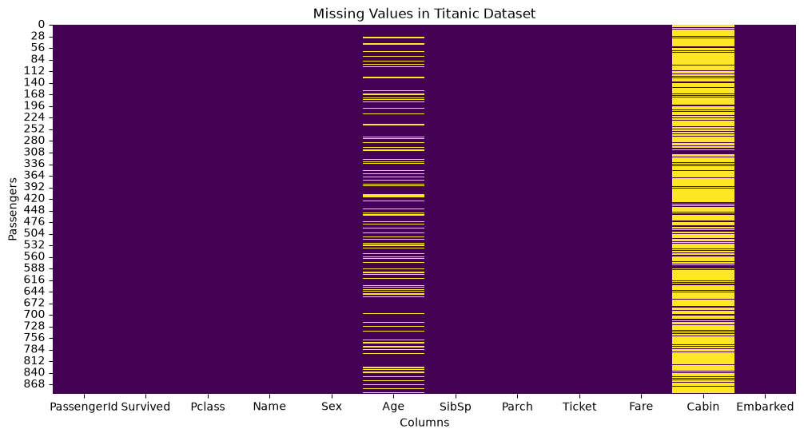
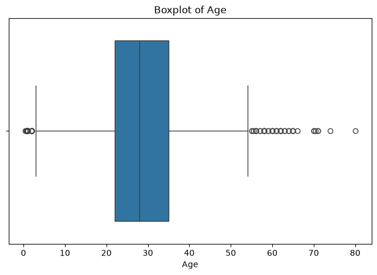
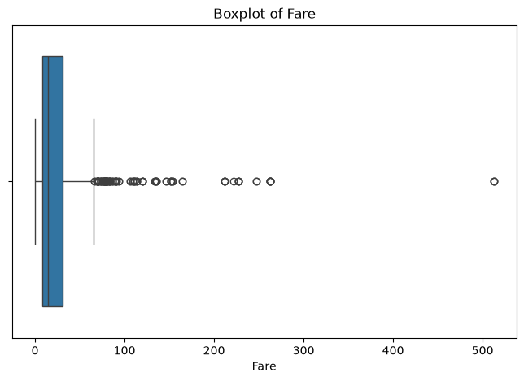

# Task 1: Data Cleaning & Preprocessing


## Overview

This project focuses on cleaning and preprocessing raw data to prepare it for Machine Learning applications.

Using the **Titanic Dataset**, I implemented essential data preprocessing techniques with Python, Pandas, NumPy, Matplotlib, Seaborn, and Scikit-learn.

## Objectives

- Explore dataset structure and identify data quality issues.
- Detect and handle missing values.
- Encode categorical variables into numerical representations.
- Apply normalization and standardization.
- Visualize and detect outliers using boxplots.
- Remove outliers using the IQR method.
- Export the cleaned dataset.

## Dataset

**Titanic Dataset** — 891 rows and 12 columns.

The dataset contains passenger information, including age, gender, passenger class, fare, cabin, and survival status.

**Source:** [Titanic Dataset – Kaggle](https://www.kaggle.com/datasets/yasserh/titanic-dataset)

## Technologies Used

| Technology | Purpose |
|---|---|
| Python | Programming |
| Pandas | Data manipulation |
| NumPy | Numerical operations |
| Matplotlib | Visualization |
| Seaborn | Statistical visualization |
| Scikit-learn | Encoding and feature scaling |
| Jupyter Notebook | Code execution |
| VS Code | Development environment |

## Implementation

The following preprocessing techniques were implemented:

1. **Data Exploration:** Examined dataset dimensions, column names, data types, and statistical summaries.
2. **Missing Value Analysis:** Identified missing values using Pandas and visualized them with a heatmap.
3. **Missing Value Treatment:** Used median imputation for Age, mode imputation for Embarked, and removed the Cabin column due to extensive missing values.
4. **Categorical Encoding:** Applied One-Hot Encoding to Sex and Embarked.
5. **Outlier Detection:** Used Seaborn boxplots to visualize potential outliers in Age and Fare.
6. **Outlier Removal:** Applied the Interquartile Range (IQR) method to the Fare column.
7. **Feature Scaling:** Demonstrated Min-Max Normalization and Standardization using Scikit-learn.
8. **Data Export:** Saved the processed dataset as a separate CSV file.

## Project Structure

```text
Task-1-Data-Cleaning-Preprocessing/
│
├── dataset/
│   ├── Titanic-Dataset.csv
│   └── titanic_cleaned.csv
│
├── notebooks/
│   └── data_preprocessing.ipynb
│
├── screenshots/
│   ├── boxplot-of-age.png
│   ├── boxplot-of-fare.png
│   └── missing-values.png
│
├── README.md
└── requirements.txt
```

## Visualizations

### Missing Values Analysis



### Outlier Detection — Age



### Outlier Detection — Fare



## How to Run

Clone the repository:

```bash
git clone YOUR_REPOSITORY_URL
```

Install dependencies:

```bash
pip install -r requirements.txt
```

Open the project in VS Code and run:

`notebooks/data_preprocessing.ipynb`

## Key Learnings

Through this project, I gained practical experience in:

- Data cleaning and missing value imputation.
- Categorical feature encoding.
- Normalization and standardization.
- Statistical outlier detection and removal.
- Exploratory data analysis and visualization.
- Preparing datasets for Machine Learning workflows.

## Conclusion

This project strengthened my understanding of data preprocessing and demonstrated how raw datasets can be transformed into cleaner, more structured data for Machine Learning applications.

---

**Task:** 01 – Data Cleaning & Preprocessing  
**Dataset:** Titanic Dataset  
**Environment:** Python | VS Code | Jupyter Notebook  
**Status:** Completed