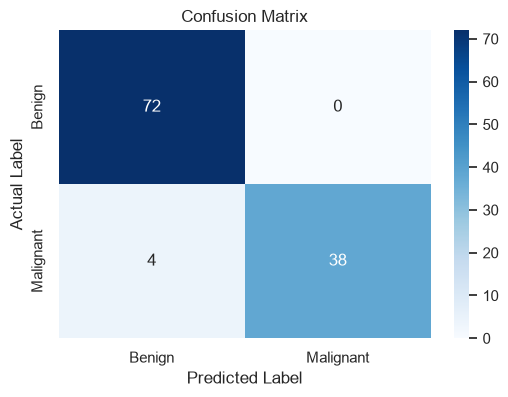
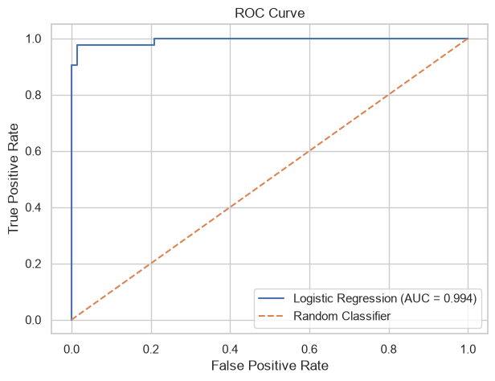
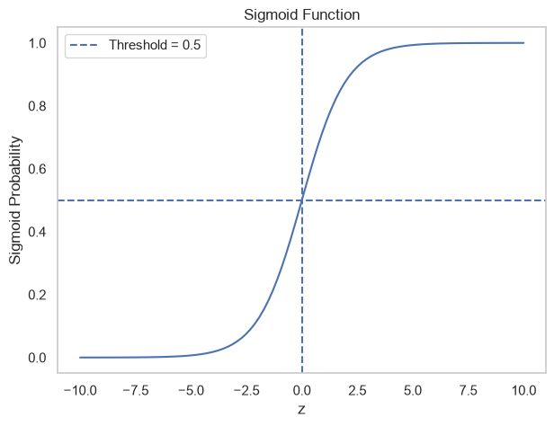
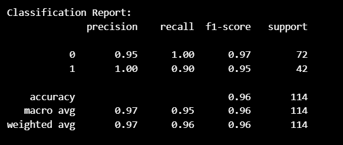

# Task 4: Classification with Logistic Regression

## 📌 Project Overview

This project demonstrates **Binary Classification using Logistic Regression** with the Breast Cancer Wisconsin Diagnostic dataset.

The objective is to predict whether a tumour is **Malignant (Cancerous)** or **Benign (Non-cancerous)** based on its features.

## 🎯 Objectives

- Understand Logistic Regression and binary classification.
- Perform Exploratory Data Analysis (EDA).
- Preprocess and standardize numerical features.
- Train a Logistic Regression model.
- Evaluate model performance using classification metrics.
- Visualize the Confusion Matrix and ROC Curve.
- Experiment with different classification thresholds.

## 📊 Dataset

**Breast Cancer Wisconsin (Diagnostic) Dataset**

- Source: Scikit-learn built-in dataset
- Total Samples: 569
- Total Features: 30
- Target Variable: Diagnosis

| Class | Label | Description |
|---|---:|---|
| Benign | 0 | Non-cancerous |
| Malignant | 1 | Cancerous |

**Note:** The dataset is loaded directly from Scikit-learn, so no separate dataset file is required.

## 📂 Project Structure

```text
Task-4-Logistic-Regression/
│
├── images/
│   ├── confusion_matrix.png
│   ├── roc_curve.png
│   ├── sigmoid_function.png
│   └── model_evaluation.png
│
├── logistic_regression.ipynb
├── requirements.txt
└── README.md
```

## 🧠 Key Concepts

| Concept | Simple Explanation |
|---|---|
| Logistic Regression | A supervised algorithm used for classification. |
| Binary Classification | Predicting one of two possible classes. |
| Features (X) | Input variables used for prediction. |
| Target (y) | The output variable to predict. |
| Train-Test Split | Dividing data for training and final evaluation. |
| Standardization | Scaling features to have approximately zero mean and unit variance. |
| Sigmoid Function | Converts a numerical value into a probability between 0 and 1. |
| Classification Threshold | A cutoff used to convert probabilities into class labels. |
| Confusion Matrix | Compares actual and predicted class labels. |
| ROC-AUC | Measures how well a model distinguishes between two classes. |
| Class Imbalance | When one class has significantly more samples than another. |

### Sigmoid Function

Logistic Regression uses the sigmoid function to convert its output into a probability.

\[
\sigma(z)=\frac{1}{1+e^{-z}}
\]

The output always falls between 0 and 1.

## 📈 Evaluation Metrics

| Metric | Meaning |
|---|---|
| Accuracy | Overall proportion of correct predictions. |
| Precision | How many predicted positive cases are actually positive. |
| Recall | How many actual positive cases are correctly identified. |
| F1-Score | Harmonic mean of Precision and Recall. |
| ROC-AUC | Measures the model's ability to distinguish between classes. |

## ⚙️ Technologies Used

- Python
- Pandas
- NumPy
- Matplotlib
- Seaborn
- Scikit-learn
- Jupyter Notebook
- Visual Studio Code (VS Code)

## 🔄 Project Workflow

1. Load the Breast Cancer dataset.
2. Perform Exploratory Data Analysis (EDA).
3. Check missing values and duplicate records.
4. Visualize class distribution.
5. Separate features and target.
6. Split data into training, validation, and testing sets.
7. Standardize features using StandardScaler.
8. Train the Logistic Regression model.
9. Generate predictions and probabilities.
10. Evaluate using classification metrics.
11. Visualize the Confusion Matrix and ROC Curve.
12. Tune the classification threshold using validation data.
13. Evaluate the tuned model on the test dataset.

## 📷 Project Visualizations

### 1. Confusion Matrix



### 2. ROC Curve



### 3. Sigmoid Function



### 4. Model Evaluation



## 💻 Installation and Setup

### 1. Clone the Repository

```bash
git clone <your-repository-url>
cd Task-4-Logistic-Regression
```

### 2. Create a Virtual Environment

```bash
python -m venv .venv
```

### 3. Activate the Environment (Windows CMD)

```cmd
.venv\Scripts\activate
```

### 4. Install Dependencies

```bash
pip install -r requirements.txt
```

### 5. Open in VS Code

```bash
code .
```

Open `logistic_regression.ipynb` and select the Python kernel associated with your virtual environment.

Run the notebook cells sequentially.

## 🎤 Interview Questions and Answers

### 1. What is the difference between Linear Regression and Logistic Regression?

**Linear Regression** predicts continuous numerical values, while **Logistic Regression** predicts the probability of a class and is used for classification.

### 2. Why is it called Logistic Regression?

Although it is used for classification, it models the relationship between input features and the log-odds of the target class using a linear equation.

### 3. What is the Sigmoid Function?

The sigmoid function converts any real-valued input into a probability between 0 and 1.

### 4. What is the difference between Precision and Recall?

- **Precision:** Out of all predicted positive cases, how many are actually positive?
- **Recall:** Out of all actual positive cases, how many did the model correctly identify?

### 5. What is a Confusion Matrix?

It is a table that compares actual and predicted labels using True Positive, True Negative, False Positive, and False Negative.

### 6. What is ROC-AUC?

ROC-AUC measures how well a classification model separates positive and negative classes. A higher AUC generally indicates better discrimination.

### 7. What is Class Imbalance?

Class imbalance occurs when one class has significantly more samples than another. Accuracy alone may become misleading, so Precision, Recall, and F1-Score are useful.

### 8. Why do we tune the classification threshold?

The default threshold is 0.5, but changing it can improve Recall or Precision depending on the problem's requirements.

### 9. How does Logistic Regression handle multiclass classification?

It can use One-vs-Rest (OvR) or Multinomial Logistic Regression to classify more than two classes.

### 10. Why is Feature Standardization important?

Features with different numerical scales can affect model optimization. Standardization puts them on a comparable scale.

### 11. What is Overfitting?

Overfitting occurs when a model learns the training data too closely and performs poorly on unseen data.

### 12. Why do we use a Validation Set?

A validation set helps tune model settings, such as the classification threshold, without using the final test data.

## 📚 Learning Outcomes

Through this project, I learned:

- The fundamentals of Logistic Regression.
- How binary classification works.
- Data exploration and preprocessing.
- Feature standardization using Scikit-learn.
- Model training and performance evaluation.
- The importance of Precision, Recall, and ROC-AUC.
- How classification thresholds affect predictions.

## 👤 Author

**Tawfica Bhuiyan**

- GitHub: [TawficaBhuiyan](https://github.com/TawficaBhuiyan)

---

