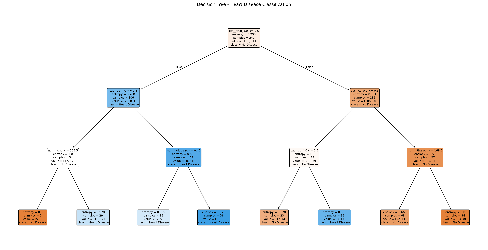
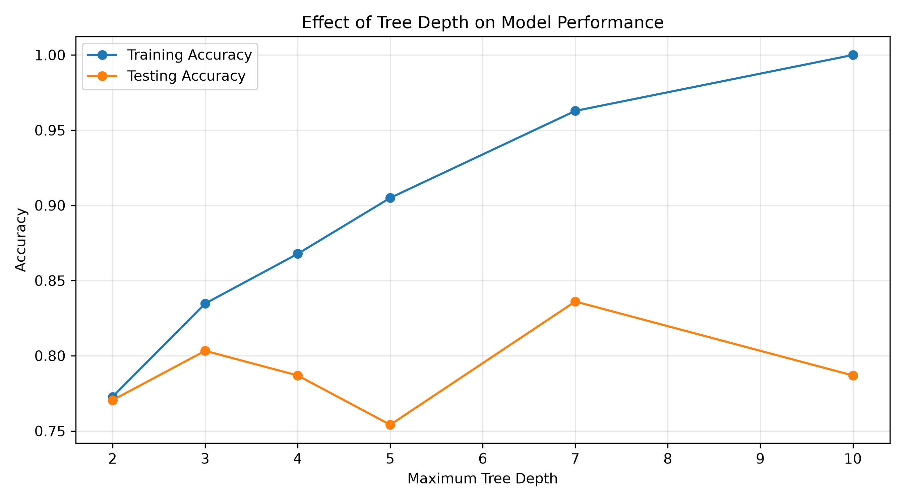
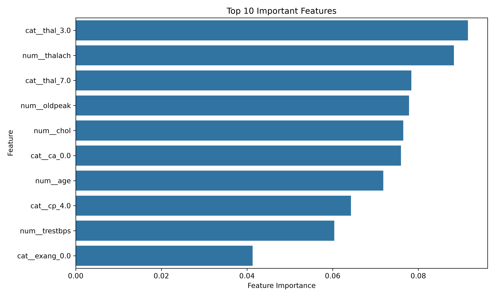
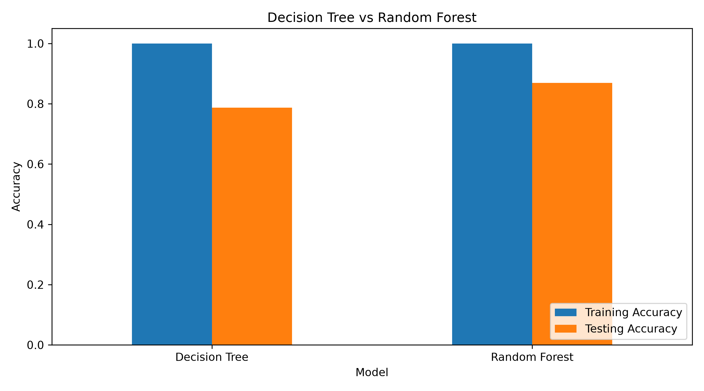
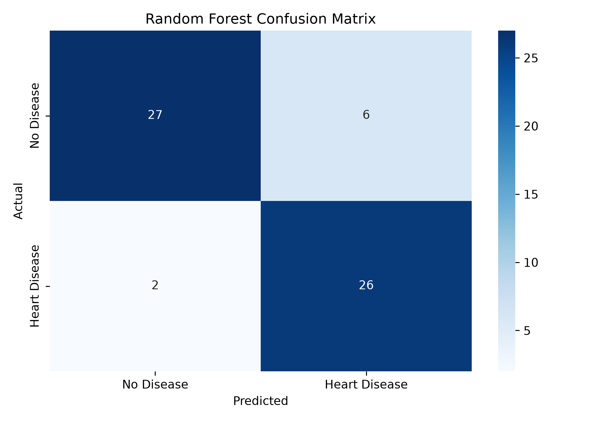

# Task 5: Decision Trees and Random Forests

## Overview

This project explores tree-based machine learning algorithms using the UCI Heart Disease (Cleveland) dataset.

The primary objective is to build classification models using Decision Tree and Random Forest algorithms, analyze overfitting, control tree complexity, interpret feature importance, and evaluate model performance using cross-validation.

## Objectives

- Train a Decision Tree Classifier.
- Visualize the Decision Tree using Matplotlib and Graphviz.
- Analyze overfitting and control tree depth.
- Train a Random Forest Classifier.
- Compare the performance of both models.
- Interpret feature importance.
- Evaluate models using 5-Fold Stratified Cross-Validation.


## Dataset

**UCI Heart Disease Dataset – Cleveland Subset**

Source: [UCI Machine Learning Repository](https://archive.ics.uci.edu/dataset/45/heart+disease)

Dataset characteristics:

- Total instances: 303
- Input features: 13
- Original target classes: 0, 1, 2, 3, 4
- Task: Binary Classification

### Target Variable

The original target variable represents the presence of heart disease.

For binary classification:

| Original Value | New Label | Meaning |
|---|---|---|
| 0 | 0 | No Heart Disease |
| 1–4 | 1 | Heart Disease |

### Input Features

| Feature | Description |
|---|---|
| age | Age of the patient |
| sex | Sex |
| cp | Chest pain type |
| trestbps | Resting blood pressure |
| chol | Serum cholesterol |
| fbs | Fasting blood sugar |
| restecg | Resting ECG result |
| thalach | Maximum heart rate |
| exang | Exercise-induced angina |
| oldpeak | ST depression |
| slope | Slope of peak exercise ST segment |
| ca | Number of major vessels |
| thal | Thalassemia-related test category |

## Technologies Used

- Python
- Scikit-learn
- Pandas
- NumPy
- Matplotlib
- Seaborn
- Graphviz
- Jupyter Notebook

## Project Structure

```text
Task-5-Decision-Trees-and-Random-Forests/
│
├── notebooks/
│   └── decision_tree_random_forest.ipynb
│
├── images/
│   ├── decision_tree.png
│   ├── decision_tree_graphviz.png
│   ├── overfitting_analysis.png
│   ├── feature_importance.png
│   ├── model_comparison.png
│   └── confusion_matrix.png
│
├── README.md
├── requirements.txt
└── .gitignore
```

## Concepts Covered

### 1. Decision Tree

A supervised learning algorithm that makes predictions by splitting data based on feature conditions.

### 2. Entropy

Measures the impurity or uncertainty of a dataset.

### 3. Information Gain

Measures the reduction in entropy after splitting a dataset.

### 4. Overfitting

Occurs when a model learns training data too closely and performs poorly on unseen data.

Controlled using parameters such as `max_depth`, `min_samples_split`, and `min_samples_leaf`.

### 5. Random Forest

An ensemble learning algorithm that combines multiple decision trees and uses majority voting for classification.

### 6. Bagging

Bootstrap Aggregating trains multiple models on different bootstrap samples and combines their predictions.

### 7. Feature Importance

Indicates the relative contribution of input features to the model's predictions.

### 8. Cross-Validation

5-Fold Stratified Cross-Validation evaluates model performance using five different training-validation splits while maintaining class proportions.

## Data Preprocessing

The following preprocessing techniques are applied:

- Numerical missing values are handled using median imputation.
- Categorical missing values are handled using most-frequent imputation.
- Categorical features are converted using One-Hot Encoding.
- Data is divided into training and testing sets using an 80:20 split.
- Stratification is used to maintain class distribution.

All preprocessing steps are integrated into Scikit-learn Pipelines to prevent data leakage.

## Models Implemented

| Algorithm | Purpose |
|---|---|
| DecisionTreeClassifier | Binary classification |
| RandomForestClassifier | Ensemble classification |

## Model Evaluation

The models are evaluated using:

- Accuracy
- Precision
- Recall
- F1-score
- Confusion Matrix
- 5-Fold Stratified Cross-Validation

## Visualizations

### Decision Tree



### Overfitting Analysis



### Feature Importance



### Model Comparison



### Confusion Matrix



## Results and Analysis

The project compares Decision Tree and Random Forest based on training accuracy, testing accuracy, precision, recall, F1-score, and cross-validation performance.

The depth analysis demonstrates how model complexity affects training and testing performance.

Feature importance analysis identifies which input features contribute most to the trained Random Forest model.

Actual performance metrics and observations are reported in the notebook after execution.

## How to Run

### 1. Clone the Repository

```bash
git clone YOUR_REPOSITORY_URL
cd Task-5-Decision-Trees-and-Random-Forests
```

### 2. Create and Activate Environment

```bash
conda create -n task5 python=3.11 -y
conda activate task5
```

### 3. Install Dependencies

```bash
pip install -r requirements.txt
```

Install Graphviz separately if necessary:

```bash
conda install -c conda-forge graphviz python-graphviz -y
```

### 4. Run the Notebook

```bash
code .
```

Open `notebooks/decision_tree_random_forest.ipynb`, select the Task 5 kernel, and run all cells sequentially.

An internet connection is required to retrieve the dataset from UCI.

## Learning Outcomes

After completing this project, I gained practical experience in:

- Building Decision Tree classification models.
- Understanding entropy and information gain.
- Detecting and controlling overfitting.
- Implementing Random Forest.
- Applying ensemble learning and bagging.
- Interpreting feature importance.
- Visualizing decision trees.
- Evaluating models using cross-validation.

## Dataset Citation

Janosi, A., Steinbrunn, W., Pfisterer, M., & Detrano, R. (1989). Heart Disease. UCI Machine Learning Repository. https://doi.org/10.24432/C52P4X

---
